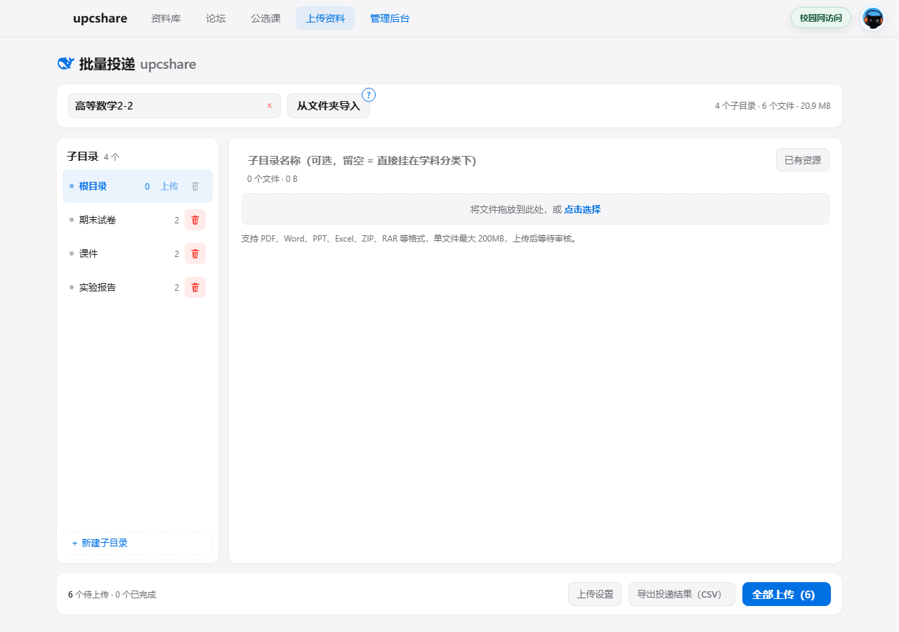

<div align="center">
  
  <h1>upcshare 批量投递</h1>
  <p>选一个文件夹自动拆成「学科分类 / 子目录」，或者手动建好结构再往里拖文件，一次传完。</p>

  <p>
    
    
    
    
    
    
    
  </p>

  <p>
    <a href="#快速开始">快速开始</a> ·
    <a href="#安装">安装</a> ·
    <a href="#使用">使用</a> ·
    <a href="#常见问题">FAQ</a> ·
    <a href="#安全与隐私">安全与隐私</a> ·
    <a href="AGENTS.md">接手的 agent 看这里</a>
  </p>
</div>



---

## 目录

- [这是什么](#这是什么)
- [它替你做什么](#它替你做什么)
- [功能一览](#功能一览)
- [快速开始](#快速开始)
- [安装](#安装)
- [使用](#使用)
  - [三种开始方式](#三种开始方式)
  - [推荐的文件夹结构](#推荐的文件夹结构)
  - [不想先整理文件夹](#不想先整理文件夹)
  - [上传设置](#上传设置)
- [工作原理](#工作原理)
- [为什么传得慢](#为什么传得慢)
- [安全与隐私](#安全与隐私)
- [常见问题](#常见问题)
- [已知限制](#已知限制)
- [测试与验证](#测试与验证)
- [路线图](#路线图)
- [贡献与反馈](#贡献与反馈)
- [致谢](#致谢)
- [许可证](#许可证)
- [交接给其他 agent](#交接给其他-agent)

## 这是什么

一个 Chrome 扩展（MV3 内容脚本），注入到 [upcshare](https://in.upcshare.cn) 的资料上传页，
把"一次只能传一个文件"的表单变成一个批量工作台。

upcshare 是校内共享课程资料的平台：课件、试卷、实验报告、复习资料。站点自己的上传入口一次只能
选一个文件、填一次学科分类和子目录、点一次上传——一学期攒下来几十上百个文件，重复劳动比整理
资料本身还费时间。

**它不是**：服务端程序（没有后端、没有数据库、没有构建步骤）、爬虫（只操作你自己登录的账号）、
站点的改动（[upc-share](https://github.com/foggy-33/upc-share) 仓库一行代码都没动）。

## 三种形态

同一套规则有两种形态，按需选择：

- **站点内置页**（推荐，[PR #1](https://github.com/foggy-33/upc-share/pull/1) 合并后可用）：`/admin` 直接就是批量工作台，**外观与本插件同一套**（同样的页头、卡片、尺寸），不用装任何东西。
- **本插件**（实验性作品，可以当成"另一个皮肤"）：功能与规则和上面那份一致，外观也同一套，区别只在形态——它是覆盖在站点上的独立面板，随时可开可关，也不用等上游合并。
- **Edge 版**（功能与 Chrome 版完全一致）：源码与安装说明在 [edge/](edge/) 目录，`edge://extensions` → 开发人员模式 → 加载解压缩的扩展即可，详见 [edge/README.md](edge/README.md)。

两者共用同一批纯函数与 31 条单测；哪边顺手用哪边。

## 它替你做什么

| 手动上传 | 用这个插件 |
|---|---|
| 100 次点选文件 | 1 次选文件夹 |
| 100 次填学科分类 / 子目录 | 按文件夹层级自动填好，还能批量改 |
| 传重复了自己都不知道 | 上传前和站内 500+ 条记录比对，默认跳过 |
| 断在 60% 只能重来 | 重跑时已传的自动跳过 |
| 传完还得去后台一个个点通过 | 可选自动通过（仅管理员） |

## 功能一览

- **两种入口**：选文件夹自动拆结构，或手动建学科分类 / 子目录再拖文件。
- **看得见规模的导入确认**：选完文件夹先告诉你「几个文件、几个子目录、生成哪个学科分类」，再决定要不要导。
- **三栏工作台**：学科分类 → 子目录 → 文件，只有一个视图，切到别的页面自动关闭并清空。
- **查重按分类作用域**：同名同大小默认跳过；同名不同大小只标黄不跳过（可能是新版本）。
- **限速排队**：按站点 Nginx 的 6 次/分钟做令牌桶，429 / 5xx 自动退避重试，不给站点添乱。
- **只试运行**：把计划打在日志里，一个字节都不传。
- **管理员工具**：自动通过审核、「已有资源」查看并删除本目录的站内文件（两段式确认）。
- **拖文件夹也行**：整个文件夹拖进虚线框，会按「学科分类 / 子目录」递归展开（一个文件夹超过 100 个文件也完整），和点「从文件夹导入」走同一条识别链路。
- **传完能核对**：底部队列的「导出投递结果（CSV）」导一张 UTF-8 CSV（BOM + 落点 / 状态 / 站内 id / 失败原因），断在中间也能人工对账。
- **看得懂的帮助**：「从文件夹导入」右上角那颗「?」就是整理规范（悬停或键盘聚焦会浮出说明），可以整段复制走，界面上的规则和它由同一条测试绑住。
- **长得像站点自己的页面**：颜色、圆角、字体在运行时取自站点 CSS token，明暗主题联动。
- **零依赖、零构建**：一个 `content.js`，`chrome://extensions` 里点刷新就生效。

## 快速开始

```text
1. 安装（下面的[安装](#安装)一节，三步）
2. 打开 in.upcshare.cn 并登录 → 点导航栏「上传资料」
3. 选一个学科分类 → 从文件夹导入 → 勾上「只试运行」先看一遍计划
4. 确认无误，取消试运行 → 全部上传
```

第一次用强烈建议先跑一遍**只试运行**：它不上传任何东西，只在底部日志里列出
「哪个文件 → 落到哪个学科分类 / 子目录」，看一眼就知道结构对不对。

## 安装

**前置条件**：Chrome 120 左右或更新（实测 156）、能在校园网访问 `in.upcshare.cn`、
一个已注册的 upcshare 账号。**不需要** Node、不需要 npm、不需要任何构建工具。

1. 把 `upcshare-batch-uploader` 文件夹解压到电脑上任意位置（**不要**在压缩包里直接操作）。
2. Chrome 地址栏打开 `chrome://extensions` → 右上角打开「开发者模式」。
3. 点「加载已解压的扩展程序」→ 选中 `upcshare-batch-uploader` 文件夹（里面能看到 `manifest.json`）。

也可以直接从 [Releases](https://github.com/pierrotto12138-code/upc-batch-uploader/releases) 下载 zip 再解压。

**用 Edge？** 功能与 Chrome 版完全相同，源码在 [edge/](edge/)：`edge://extensions` → 左下角「开发人员模式」→「加载解压缩的扩展」→ 选 `edge/` 目录。安装细节见 [edge/README.md](edge/README.md)。

然后打开 <https://in.upcshare.cn> 并登录，点顶部导航栏的 **「上传资料」**，就会进入批量投递页面。
没反应就刷新一次页面。

> 只在 `in.upcshare.cn`、`upcshare.cn`、`www.upcshare.cn` 三个域名生效，其它网站不会注入。
> 卸载：`chrome://extensions` → 移除，不留任何东西（插件零持久化）。

## 使用

点「上传资料」会像原站一样跳到 `/admin`，在导航栏下方展开工作台——它看起来就是站点自己的一个
页面（标题 + 几块卡片），不是浮在上面的窗口；顶部导航保留，切到别的页面会自动关闭并清空。

### 三种开始方式

都在页面顶部的学科分类栏上：

1. **选择已有学科分类** — 点输入框，下拉列出站内全部学科分类（可打字模糊搜索）。选中后自动带出
   该分类在站内已有的子目录（只列子目录，不列文件）。
2. **新建学科分类** — 直接在输入框里打一个站内没有的名字。
3. **从文件夹导入** — 旁边的按钮。选完文件夹会先弹一次确认（几个文件、几个子目录、生成哪个学科
   分类），确认后按文件夹层级自动建结构。检测到多个学科分类时会让你选一个导入。

拿不准文件夹该怎么摆？「从文件夹导入」右上角有颗「**?**」（悬停显示「查看文件夹导入规范」），点开是一份完整的整理规范
（目录结构模板、命名与格式限制、上传后会发生什么、建议顺序），下方「复制 prompt」可以整段拷走，
发给同学或丢给 AI 让它照着整理。

结构是 **学科分类 → 子目录 → 文件**：

- 左侧是子目录列表，点「＋ 新建子目录」添加、点行切换。**没选学科分类时这颗按钮是灰的**——
  子目录必须挂在某个学科分类下面。
- 文件直接放在学科分类下的那种情况也算一个子目录，显示为「根目录」。
- 子目录名下拉**只列这个分类自己用过的子目录**，不会混进别的分类的。
- 每个子目录行右侧有「上传（N）」和 `⋯` 菜单。菜单内容按能不能改给：本次新建的有
  上传本子目录 / 重命名 / 从本次列表移除；站内已有的只给上传本子目录。
- **站内已有的子目录不给改名、也不给"删除子目录"**：站点既没有改名接口，也没有"子目录"这个实体
  （有文件才有目录）。要清掉一个目录，就在「已有资源」里把里面的文件删完，它会自动消失。
- 右侧只显示当前子目录的文件，可以拖文件进来，或点「点击选择」。
- **选错了想重来**：学科分类输入框右端有个小红 ×（选了才出现），点一下把学科分类连同它的子目录
  一起清掉；已经拖进文件时会先问你一次。
- 底部「全部上传」处理当前学科分类的所有子目录。
- 上传时底部出现进度和日志，整理操作会暂时锁定，只留「停止」。

### 推荐的文件夹结构

插件按文件夹层级理解学科分类和子目录，照站点的结构摆最省事：

```text
我的课程资料/
├── 高等数学2-2/
│   ├── 期末试卷/
│   │   └── 2024-2025 期末真题.pdf
│   └── 课件/
│       └── 第 1 章 极限.pptx
└── 大学物理/
    └── 实验报告/
        └── 实验一 单摆.pdf
```

判断规则（对不上就手改，永远你说了算）：

- 选中的文件夹本身就叫「高等数学2-2」→ 它算学科分类；
- 选中的是「我的课程资料」这类容器名 → 第一层是学科分类、第二层是子目录；
- 依据是和站内已有的学科分类名比对，比不过才按层数猜。

### 不想先整理文件夹

在空面板里选好学科分类 → 点「＋ 新建子目录」→ 右侧拖文件或点「点击选择」。不需要在硬盘上先建
目录，站点会在上传时按你填的学科分类 / 子目录落盘。一个子目录传完可以先点「上传本子目录」，剩下
的以后再说。

> ⚠️ 刷新页面会清空当前学科分类和已选文件（浏览器不允许脚本保留你选过的文件句柄）。
> 这是刻意的，理由见 [docs/design.md](docs/design.md) 第 8 条。整理到一半别刷新。

### 上传设置

| 开关 | 默认 | 作用 |
|---|---|---|
| 跳过站内已存在的文件 | 开 | 按「文件名 + 大小」和站内**已通过 + 待审核**比对；同名不同大小标黄但不自动跳过 |
| 投递后自动通过审核 | 关 | 管理员专属（非管理员既看不到也点不动），传完直接 `approved` |
| 只试运行，不真正上传 | 关 | 只把计划打在日志里，零流量 |

## 工作原理

```text
选中文件夹 ── webkitRelativePath ──┐
                                   ├─→ 按「学科分类 / 子目录」分组（同组自动合并）
手动建结构 + 拖文件 ───────────────┘
   ↓
拉取站内索引（已通过 + 待审核）── 标出重复 / 超大 / 非法 / 不支持
   ↓  你确认（可只传某个子目录）
令牌桶排队上传（先放 3 个，之后每 10.5 秒一个）
   ↓  XHR 带进度；429 / 5xx 自动退避重试，最多 4 次
可选：调用 /api/admin/approve/{id} 自动通过审核
```

三条关键实现选择：

- **同源运行**：逻辑跑在站点页面里，请求一律写 `/api/...`，直接用你已登录的 Cookie——
  跨源 `fetch` 会丢 Cookie，所以这条路是硬约束，不是偷懒。
- **Shadow DOM 隔离**：不污染站点样式，也不被站点的全局 CSS 污染。
- **接口不变**：上传走站点自己的 `/api/upload`，和手动点「上传资料」是同一个接口、同一套校验。

## 为什么传得慢

站点 Nginx 限速：`6 次/分钟`、`burst 3`、`并发 2`。插件按"先放 3 个、之后每 10.5 秒一个"排队，
撞到 429 自动等 15 秒重试。**100 个文件 ≈ 17 分钟起步。**

这比一个个手点、传一半失败再重来要稳得多。想更快只能改服务器限速——插件这侧不建议硬冲，
`limit_conn 2` 会直接把请求打成 429，反而更慢，还会给站点留坏流量。

## 安全与隐私

- **没有密码输入框**，也不需要你的账号密码；用的是浏览器里现成的登录态。
- **零持久化**：不写 `localStorage`、不写 Cookie、不存文件句柄，刷新即清空。
- **不外发**：不向任何第三方发送 Cookie 或文件内容，请求只打到 `in.upcshare.cn` 自己的接口。
- **可审计**：代码就一个 `content.js`，没有压缩、没有混淆、没有远程加载脚本，`grep` 一遍就懂。
- **权限最小**：`manifest.json` 里没有任何 `permissions`，`matches` 只有三个 upcshare 域名。
- **删不掉别人的东西**：唯一能删的是站内文件，且仅管理员、且必须点两次确认；
  「已有资源」的列表按当前学科分类 + 当前子目录过滤（待审核接口是全站范围的，插件侧自己筛）。
- **灌不出空目录**：站点没有"建目录"接口，目录只是文件落盘时顺带形成的路径段；
  空子目录凑不出任何上传目标，行上的「上传」在没有待传文件时直接禁用。
- 卸载即彻底移除。

## 常见问题

<details>
<summary><b>按钮不出现 / 点了没反应？</b></summary>

确认地址是 `https://in.upcshare.cn`（不是 `http://`、不是别的域名），刷新一次页面；
到 `chrome://extensions` 确认插件是启用状态，改过代码的话点一下刷新图标。
</details>

<details>
<summary><b>提示「请先在页面上登录」？</b></summary>

先点网站右上角登录，再进「上传资料」——插件每次打开都会重新确认登录态。
</details>

<details>
<summary><b>「＋ 新建子目录」是灰的？</b></summary>

因为子目录必须挂在某个学科分类下面。先在上方选一个或输入一个新学科分类，按钮就亮了。
</details>

<details>
<summary><b>一直 429？</b></summary>

站点限速到了。插件会自动等 15 秒重试；连续失败就停下来等几分钟再传，已经传成功的不会重复。
</details>

<details>
<summary><b>传上去为什么前台看不到？</b></summary>

正常，新上传的文件是「待审核」状态。勾上「自动通过审核」（管理员），或者去后台点通过。
</details>

<details>
<summary><b>Chrome 提示「可以读取和更改您在所有网站上的数据」？</b></summary>

任何内容脚本扩展都会这么提示。本插件 `manifest.json` 的 `matches` 只有三个 upcshare 域名，
其它网站不会注入。
</details>

<details>
<summary><b>能不能撤回传错的文件？</b></summary>

插件不做"一键撤回"这种危险操作。管理员可以在对应子目录打开「已有资源」，逐条删除（点两次确认）；
普通成员去后台的「文件审核」处理。
</details>

## 已知限制

| 限制 | 说明 |
|---|---|
| 单文件 ≤ 200MB | 插件按产品要求收紧到 200MB；站点本身允许 1GB。超限标红跳过 |
| 只收白名单格式 | pdf / doc / docx / zip / rar / 7z / tar / gz / ppt / pptx / xls / xlsx / txt / md / csv |
| 子目录最多两级 | 更深的层级会拼成 `课件/第一章`（和站点扫描器规则一致） |
| 同名不同大小不自动跳过 | 只标黄——它可能是新版本，也可能是传错了 |
| 刷新页面丢状态 | 分组数据只在内存；重新选一次文件夹即可，已传的会被自动跳过 |
| 不支持拖文件夹递归 | 拖文件可以，拖整个文件夹请走「从文件夹导入」 |
| 真人手感未测 | 无头测试测不了滚轮手感、拖拽手感和几百 MB 大文件的进度表现 |

## 测试与验证

| 层 | 覆盖 | 怎么跑 |
|---|---|---|
| 单元测试（31 项） | 路径折算、学科分类模糊匹配、按分类作用域的查重、目录收集、默认名编号、限速器 | `node selftest.js` |
| 端到端（62 项断言） | 注入 → 登录 → 真实鼠标点导航进 `/admin` → 融入站点外观与纵向铺满 → 整理规范弹层（内容 / 复制反馈 / 关闭）→ 课程栏三个盒子对齐 → 门禁与下拉 → 导入确认 → 建/改名/移除子目录 → 试运行 → 真实上传 → 自动审核 → 站内校验 → 已有资源两步删除 → 换分类清空 → 探针清理 | `.\tools\headless.ps1 -User <账号> -Password <密码>` |

最近一次实测：2026-10-31，生产站 62 项断言全过、站点无残留、退出码 0。
端到端会往生产站上传一个 17 字节的探针文件，跑完自动删除（失败时也有兜底清理）。

## 路线图

按价值排序，完整验收标准见 [AGENTS.md](AGENTS.md#10-待办按价值排序含验收标准)：

- **P0** 拖拽文件夹递归上传（`webkitGetAsEntry`）、成功/失败清单导出 CSV
- **P1** 多级目录（学科 / 章 / 节）、整体 ETA 与暂停继续
- **P2** 与站点后台联动（传完给一个"去后台看"的链接）、限速与大小上限可配置
- **不做** `.zip` 服务端解包（站点不支持，浏览器解压大文件会炸内存）、多账号切换（超出个人工具定位）

## 贡献与反馈

改代码前先读 [docs/design.md](docs/design.md)（为什么这么写）和
[docs/api.md](docs/api.md)（接口契约实测记录）——里面有几处"看着像 bug、其实是取舍"的地方。

改完必须重跑两条：`node selftest.js` 和 `tools/headless.ps1`。改了 UI 还要重生成 `preview.png`。

遇到问题欢迎带上三样东西来问：浏览器控制台的报错、面板底部日志那一行的截图、以及文件名的
**格式**（不用给真实文件名）。错误信息里都带了原始 HTTP 状态码，方便定位。

## 致谢

- 感谢 **[upc-share](https://github.com/foggy-33/upc-share) 的作者**和所有维护者。这个平台让课程资料
  第一次有了"学长传下来、学弟找得到"的地方，为学校资源共享做出了伟大贡献。本插件只是给它加了一个
  批量入口，**没有修改它的任何一行代码**，也无意改变它的任何规则。
- 感谢 **DeepSeek V4.1 Flash** 与 **Qwen 3.8 Flash** 提供的编程能力——这个项目从接口实测、
  测试脚手架到文档，绝大部分代码是在它们的辅助下写成和反复验证的。
- 面板图标那头鲸鱼来自 [Simple Icons](https://github.com/simple-icons/simple-icons)（CC0），
  仅作装饰，不代表与任何厂商有关联。

## 许可证

[MIT](LICENSE)

## 交接给其他 agent

这个目录是**为交接准备的**：

| 你是谁 | 先看哪份 |
|---|---|
| 使用者 | 本文（README） |
| 接手的 agent / 开发者 | [AGENTS.md](AGENTS.md) —— 30 秒上手、文件地图、硬约束、踩过的坑、待办 |
| 想知道进度和验证状态 | [HANDOFF.md](HANDOFF.md) —— 做到哪、验过什么、哪些目录不能外发 |
| 想知道为什么这么设计 | [docs/design.md](docs/design.md) —— 19 条决策记录，含被推翻的旧决定 |
| 想知道接口契约 | [docs/api.md](docs/api.md) —— 全部实测，含状态码与限速 |
| 想给站点提 PR | [docs/pr-readiness.md](docs/pr-readiness.md) —— 结论、缺陷清单、要先和上游谈的三件事 |
