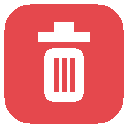

<div align="center">
  
  <h1>upcshare 资料库删除</h1>
  <p>在资料库列表里直接删文件，不用再进管理后台翻箱倒柜。</p>

  <p>
    
    
    
    
    
    
  </p>
</div>

---

## 目录

- [这是什么](#这是什么)
- [安装](#安装)
- [使用](#使用)
- [安全边界](#安全边界)
- [实现要点（改代码前看）](#实现要点改代码前看)
- [测试与验证](#测试与验证)
- [已知限制](#已知限制)
- [致谢](#致谢)
- [许可证](#许可证)

## 这是什么

一个**独立**的 Chrome / Edge MV3 内容脚本，注入到 [upcshare](https://in.upcshare.cn) 的资料库列表页，
在每一行「下载」旁边加一个「删除」按钮。删除调用的是管理后台同一个接口：

```text
DELETE /api/admin/files/{id}
```

它和仓库里的 [批量投递](../README.md) **分开安装、互不影响**，不共享代码，也不依赖对方。

## 安装

**前置条件**：Chrome / Edge（Chromium 内核），能在校园网访问 `in.upcshare.cn`，以及一个**管理员**账号。

1. 从 [Releases](https://github.com/pierrotto12138-code/upc-batch-uploader/releases) 下载
   `upcshare-row-delete-1.0.0.zip` 并解压（不要在压缩包里直接操作）。
2. Chrome 打开 `chrome://extensions`（Edge 是 `edge://extensions`），打开「开发者模式 / 开发人员模式」。
3. 点「加载已解压的扩展程序 / 加载解压缩的扩展」，选中解压出来的文件夹（里面能看到 `manifest.json`）。
4. 刷新 upcshare 页面。

> 只在 `in.upcshare.cn`、`upcshare.cn`、`www.upcshare.cn` 三个域名生效，其它网站不会注入。
> 不需要任何 `permissions`；卸载后不留东西（唯一写入的是 `sessionStorage` 里一份"本次已删的 ID"，
> 关掉标签页就没了）。

## 使用

1. 用管理员账号登录，打开**资料库**，点进任意学科分类（或直接搜索）。
2. 每行「下载」右边会出现浅红色的「删除」。
3. 第一次点，按钮变成「确认删除」并摇晃一下，**4 秒内**再点一次才真的删。
   4 秒内没点第二下就自动取消；点别的行只会把确认换到那一行。
4. 删掉的行原地收起，右下角提示「已删除：文件名」。整页删空会显示「本页文件已删除」。

普通成员和未登录用户**看不到任何按钮**。删除权限完全由站点判定：没有权限时接口返回 401/403，
提示会写明状态码。

## 安全边界

- **不碰密码和 token**：没有输入框，不写 `localStorage`，不读 Cookie。
- **同源请求**：只发 `DELETE /api/...`，靠浏览器自带的登录 Cookie，不做跨源 `fetch`。
- **只删一次**：两次确认；请求进行中按钮禁用，避免连点发两次。
- **不留生产数据**：测试用的探针文件跑完按前缀清理并回查（见下）。
- **不影响原站**：只追加一个按钮和一段样式；不改站点的 Vue 状态，不拦导航。

## 实现要点（改代码前看）

- **文件 ID 从行里拿**：列表行已有 `<a class="dl-btn-sm" href="/api/download/{id}">下载</a>`，
  不额外请求文件列表；`fileIdFromHref()` 兼容绝对 URL、查询串和转义。
- **Vue 重画会把删掉的行画回来**：列表的 `files` 数组还在内存里，搜索/翻页等任何重画都可能让行复活。
  所以删除成功的 ID 记进 `sessionStorage`，`MutationObserver` 每次扫到这些 ID 就继续隐藏；
  刷新页面后服务端本来就不会再返回它。
- **管理员判定**：启动时请求一次 `/api/auth/me`，只有 `is_admin` 才注入样式和按钮；
  非管理员页面完全不动（连样式都没有）。
- **整页删空**：Vue 自己的「暂无文件」只在 `files.length === 0` 时渲染，我们隐藏行不会触发它，
  所以补一行「本页文件已删除」占位；有新行出现就自动撤掉。
- **样式跟站点一致**：浅红底 + 红字 + 1px 软描边 + 8px 圆角 + 28px 高 / 12px·600，
  和后台 `.action-btn.delete` 同一套；颜色优先取站点 token（`--danger`），深浅主题都能用。

## 测试与验证

```powershell
node row-delete/selftest.js                 # 5 项纯逻辑，零副作用
node row-delete/tools/e2e.mjs               # 24 项本地端到端：真实加载扩展 + 真实鼠标 + mock 页面
```

本地端到端用 Edge 无头模式 `--load-extension` 加载扩展（生产清单只匹配 upcshare 三个域名，
测试用一份"只多一条 `http://127.0.0.1/*`"的清单副本，`content.js` 逐字节相同并核对 sha）。
覆盖：管理员可见 / 首次点不删 / 4 秒复位 / 第二次点才发请求 / 行收起与提示 /
模拟 Vue 重画后不复活 / 删空占位 / 普通成员什么都不多 / 按钮的 28px·8px·12px·600 规格。

生产端到端（**会真传一个 24 字节探针、跑完删除并回查**，需要账号密码，密码不落文件）：

```powershell
$env:UPC_USER='<账号>'; $env:UPC_PASSWORD='<密码>'
node row-delete/tools/prod-e2e.mjs
```

最近一次实测：**2026-11-16，生产 12 项断言全过、按前缀回查 0 条、待审核 0 条、退出码 0**。

## 已知限制

- 只有管理员能用；普通成员不会看到入口（站点接口本身也只给管理员）。
- 删除是**不可逆**的，没有回收站；所以坚持两次确认。
- 另一个标签页里已经打开的列表不会同步消失，刷新后才干净。
- 页面是 SPA：登录状态在同一标签页里失效后，按钮不会自动消失，点了会得到 401 提示。

## 致谢

感谢 [upc-share](https://github.com/foggy-33/upc-share) 的作者为学校资源共享做出的伟大贡献；
感谢 DeepSeek V4.1 Flash 与 Qwen 3.8 Flash 的优渥能力。

## 许可证

[MIT](../LICENSE)
